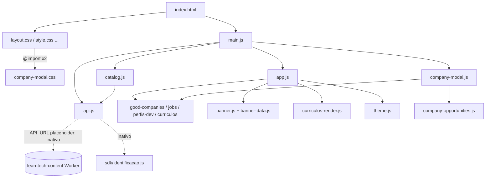
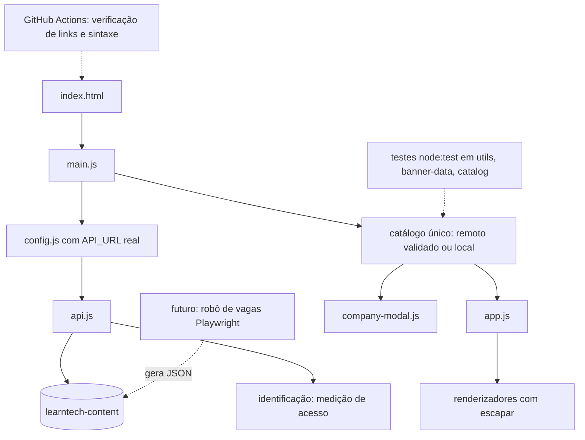

# Career: arquitetura e plano

## 1. Arquitetura atual

## 2. Arquitetura alvo (incremental, sem framework)

## 3. Decisões (ADR curto)

### ADR-01: manter HTML, CSS e JS puros, sem build
- **Contexto:** o README declara a escolha como deliberada (prática de fundamentos).
- **Decisão:** manter. As melhorias não exigem bundler.
- **Alternativas:** Vite ou Astro (minificação, otimização de imagens). Ficam descartadas por enquanto.
- **Consequências:** a otimização de imagens e o CI são feitos com ferramentas externas ao runtime.

### ADR-02: todo dado interpolado em HTML passa por `escapar()`
- **Contexto:** a API remota pode alimentar os dados. Hoje `company-modal.js` e `curriculos-render.js` montavam HTML cru.
- **Decisão:** usar `escapar()` (já existente em `utils.js`) em todas as interpolações. Executado no lote 1.
- **Alternativas:** `textContent` e `createElement` em tudo, que exigiria reescrita maior; sanitizador externo, que exigiria uma dependência.
- **Consequências:** o texto exibido não muda (os dados atuais só têm `&`, que renderiza igual). Os dados não podem mais conter HTML intencional.

### ADR-03: validar o catálogo remoto antes de usar
- **Contexto:** `usarCatalogo` assumia listas e `destaques` válidos.
- **Decisão:** `catalog.js` rejeita resposta não-lista (cai nos dados locais), e `app.js` usa o banner local se `destaques` faltar.
- **Alternativas:** um schema validator, que exigiria uma dependência.
- **Consequências:** a falha da API nunca derruba a página.

### ADR-04: identificação é regra de negócio
- **Contexto:** o SDK de identificação mede o volume de acesso (inferido · confirmar) e hoje está desligado.
- **Decisão:** nunca remover. Proposta: religar e aperfeiçoar (explicar o porquê, política de privacidade visível, lembrar a identificação entre visitas).
- **Consequências:** depende da configuração do Worker pelo dono.

### ADR-05: rede de segurança sem `package.json`
- **Contexto:** não há scripts npm. A regra é não inventar um CI que rode scripts inexistentes.
- **Decisão:** entregar `docs/claudeia/verificar.ps1` (local). O CI fica proposto (L2-01) até existir um script versionado.

## 4. Plano em lotes

| ID | Item | Motivo | Arquivos | Critério de pronto | Esforço | Risco | Muda o produto? | Situação |
|---|---|---|---|---|---|---|---|---|
| L1-01 | `og:image` absoluto | Crawlers sociais não resolvem caminho relativo | `index.html:24` | Preview no LinkedIn ou WhatsApp mostra a imagem | XS | Baixo | Não | Executado no lote 1 |
| L1-02 | Validar formato do catálogo remoto | Evitar quebra do init | `js/catalog.js` | Resposta não-lista gera aviso e usa os dados locais | XS | Baixo | Não | Executado no lote 1 |
| L1-03 | `destaques` ausente usa o banner local | Evitar TypeError | `js/app.js` (`usarCatalogo`) | Sem `destaques`, o banner local aparece | XS | Baixo | Não | Executado no lote 1 |
| L1-04 | Escapar interpolações em HTML | XSS via dados remotos | `js/company-modal.js`, `js/curriculos-render.js` | Modal e currículos idênticos visualmente; `<b>` em dado aparece como texto | S | Baixo | Não | Executado no lote 1 |
| L1-05 | Nome acessível do modal | WCAG 4.1.2 | `index.html` (`aria-labelledby`) | Leitor de tela anuncia "BRQ Digital Solutions, diálogo" | XS | Baixo | Não | Executado no lote 1 |
| L1-06 | README: remover sobra de texto de IA e completar a estrutura | Documentação correta | `Readme.md` | Fim do arquivo é `**@douglasabnovato**` | XS | Nenhum | Não | Executado no lote 1 |
| L1-07 | Script de verificação local | Rede de segurança | `docs/claudeia/verificar.ps1` | Roda sem erro na raiz | S | Nenhum | Não | Executado no lote 1 |
| L2-01 | CI no GitHub Actions (links locais e `node --check`) | Rede de segurança no PR | `.github/workflows/ci.yml`, `scripts/verificar.mjs` | PR vermelho com referência quebrada | S | Baixo | Não | Proposto |
| L2-02 | Testes `node:test` (sem dependência) para `normalizar`, `escapar`, `montarDestaques`, `carregarCatalogo` com fetch simulado | Proteger as regras R3 e R4 | `tests/*.test.mjs` | `node --test` verde no CI | M | Baixo | Não | Proposto |
| L3-01 | Redimensionar thumbs para cerca de 2× o tamanho exibido e converter para WebP | 8,5 MB → estimativa de 1 a 1,5 MB | `assets/thumb_*` | Mesma aparência; peso total abaixo de 2 MB | M | Médio (visual) | Não | Proposto |
| L3-02 | Logo do header em 80×80 | 216 KB acima da dobra | `assets/logo/logo-career.png` | Menos de 15 KB | XS | Baixo | Não | Proposto |
| L3-03 | Trocar o `@import` duplicado por `<link>` | Render-blocking serial | `css/layout.css`, `css/style.css`, `index.html` | Comparação visual idêntica nas 4 seções e no modal | S | Médio (ordem da cascata) | Não | Proposto |
| L3-04 | Focus trap e retorno de foco no modal | Acessibilidade | `js/company-modal.js` | Tab não sai do modal; ao fechar, o foco volta ao card | S | Baixo | Não | Proposto |
| L3-05 | Modal usa o catálogo ativo (remoto ou local) | Consistência | `js/company-modal.js`, `js/app.js` | Dados do modal iguais aos do card | S | Baixo | Não | Proposto |
| L3-06 | Botão de pausa no banner | WCAG 2.2.2 | `js/banner.js`, `css/banner.css` | Pausa por teclado e mouse | S | Baixo | Sim (novo controle) | Proposto |
| L3-07 | Self-host do subconjunto de ícones | Remover CSS externo bloqueante | `index.html`, `css/` | Ícones iguais, sem unpkg | M | Médio | Não | Proposto |
| L4-01 | README: público, regras R1 a R7 confirmadas, como verificar | Documentação | `Readme.md` | Dono revisou | S | Nenhum | Não | Proposto |
| P1 a P9 | Decisões de produto | Ver o relatório, seção 3 | n/a | Aprovação do dono | n/a | n/a | Sim | Proposto (aguarda aprovação) |
